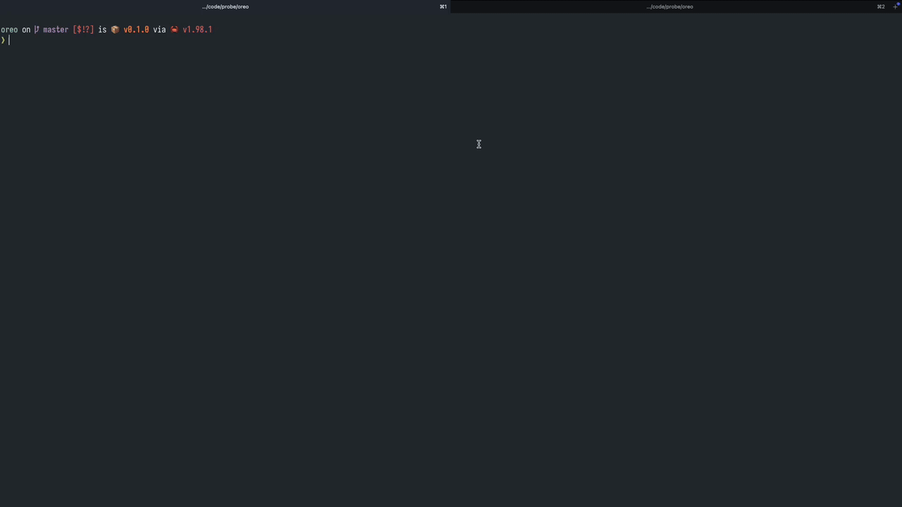

# Oreo

Oreo is a terminal file opener for command output. It finds file paths in stdin, stdout, and stderr, then lets you jump from a matching line straight into the file.

<p align="center">
  
</p>

## What it does

- Run a command inside Oreo or pipe text into it.
- Browse captured stdin, stdout, and stderr in separate tabs.
- Move through matching lines and switch between multiple paths on one line.
- Open the selected file in Neovim at its reported line, or copy its path.
- Add useful path and line-number flags automatically for `rg` and `grep`.

## Install

Requires Rust and Cargo. Install the binary from a clone of this repository:

```sh
cargo install --path .
```

## Use

Run a command and browse its output:

```sh
oreo cargo check
oreo rg -n "TODO" src/
```

Or pipe existing output into Oreo:

```sh
rg -n "TODO" src/ | oreo
```

Oreo opens the selected file with `nvim`. Use the controls below to navigate:

| Key | Action |
| --- | --- |
| `j` / `k` or arrows | Move through matches |
| `g` / `G` | Jump to the first / last match |
| `h` / `l` or arrows | Switch between stdin, stdout, and stderr |
| `Tab` / `Shift+Tab` | Select the next / previous path on the current line |
| `Enter` | Open the selected file in Neovim |
| `y` | Copy the selected path |
| `q` / `Esc` | Quit |

---

Okay, finally some clarity.

The goal is to capture some 'text', from stdin, stdout, and stderr, parse it for valid filepaths,
and render the full text for each, split per line, where you use j/k/gg/G to navigate and on click `Enter` key
it opens the file present in that line with a configureable editor (nvim by default).

In case a line contains multiple valid filepaths, use `Tab` to switch selecting between them.

This borrows from the idea of [fdired](https://github.com/Simar-malhotra09/fdired.git), but instead of
limiting ourselves to output of grep/rg/find/fd, this should, in theory, work with any arbitrary text,
whether it is piped in (stdin), or cmds are passed to the binary as args (it spawns a process to run the passed
args as is, and captures the stdout and stderr.)

Concretely, usage with stdin could look like:
(Obviously this will be a TUI, but the principle is the same)

`find ~/Desktop/slides/base_imgs -maxdepth 1 -type f | ./target/debug/cream`

```
STDIN
Matches:
  /Users/0saker/Desktop/code/tem-particle-seg/slides/base_imgs/amal-0007.tif:-:-
  /Users/0saker/Desktop/code/tem-particle-seg/slides/base_imgs/low-contrast-0018.png:-:-
  /Users/0saker/Desktop/code/tem-particle-seg/slides/base_imgs/contam-0003.tif:-:-

STDOUT
Matches:

STDERR
Matches:
```

Concretely, usage with stdout could look like:
(Obviously this will be a TUI, but the principle is the same)

`./target/debug/cream grep -r "main" tests/fixtures/`

```
STDIN
Matches:

STDOUT
Matches:
  tests/fixtures/mixed_multiline.txt:-:-
  src/main.rs:42:-
  tests/fixtures/path_with_line_number.txt:-:-

STDERR
Matches:
```

Concretely, usage with stderr could look like:
(Obviously this will be a TUI, but the principle is the same)

(Stderr shows which file fails to compile)

```
❯ cargo b
   Compiling temp v0.1.0 (/Users/0saker/Desktop/code/probe/oreo/cream/temp)
error: expected type, found `,`
  --> src/main.rs:10:11
   |
 9 | struct PathMatch {
   |        --------- while parsing this struct
10 |     path: ,
   |           ^ expected type

error: could not compile `temp` (bin "temp") due to 1 previous error
```

`../target/debug/cream cargo b`

```
Command: cargo b
STDIN
Matches:

STDOUT
Matches:

STDERR
Matches:
  src/main.rs:10:11
```

Okay this is incomprehensible

~~This is a rewrite of [fdired](https://github.com/Simar-malhotra09/fdired.git) in rust, because ofcourse!
Jokes aside, I was a little tired of how slow the progress was in C because of all the damn bug I tended to introduce with every commit,
and honestly, I couldn't be arsed to learn how to properly use a debugger at the moment.
Indeed, this project is also stained by the same human sloppness I excreated over at the C version; that, while still useable, will be archived soon.
Below is the readme of it for no reason other than to toot my own horn.~~

What else mmhh.. I'm kind of craving a sweet treat rn.

---

# fdired

Mix of fd and Emacs' Dired

<p align="center">
  
</p>

## Original Scope

[fd](https://github.com/sharkdp/fd)

[Emacs' Dired](https://www.gnu.org/software/emacs/manual/html_node/emacs/Dired.html)

Never heard of Emacs or Dired? [Watch Tsoding's "The Annoying Usefulness of Emacs"](https://www.youtube.com/watch?v=DMbrNhx2zWQ&t=84s)

Why? Something like this probably exists already but I'm unemployed atm.

Why in C? I'm equally bad with all programming languages.

What is the nob.h file? [no-build](https://github.com/tsoding/nob.h)

## Current Scope

Supports

- Find
- Fd
- Grep
- Rg

Ideally we could support any filter that spits out newline seperated filepaths + metadata

# Why is the progress so slow?

### This is pure human slop 🦅🦅🦅

As mentioned before, I kinda suck at C and there no AI except for refactoring/checking vulnerabilities occasionally

# To do:

- [ ] Grep support: '|', ".", ".*"
- [ ] Be able to filter using vim's '/' syntax. Use n/N to navigate matches.
- [x] Be able to define how to open a file. Currently uses nvim for all files but obv you won't open a pdf that way.

Status?
(2026/09/12) Use ~/.config/fdired.txt to define how to open the supported filetypes.

(2026/07/24) Add basic functionality to open diff files with diff cmd. `nvim` for ascii, `open` for pdf etc. This now needs to be read from a dedicated config file, and tested.

(2026/07/05) Added additional func mapped to keys like <Tab>(toggle btw full filepath vs rel), <y>(copy filepath) etc. The parsing logic is terrible and breaks on "abc*". Will fix soon.

(2026/06/25) Added highlighting to UI. Line numbers in green, matched syntax in red, correct symbols for j/k keys. Fix general issues.

(2026/06/19) I've expanded the scope from just supporting fd to any utility that outputs atleast a newline seperated filepath (+ more like grep/rg).
Currently we can support find, fd, grep, rg. We inject some flags at runtime to ensure we get the output in the desired format.

(2026/06/01) Minimal UI improvements; add status bar at the bottom

(2026/05/31) Rendering is mostly done. Implemented viewport to handle lazy-loading for long fd output. Nav with j/k/gg/G works well.
Next need to implt <enter> to open file $EDITOR. And there needs to be someway to go back to view as well later.
Also will make the UI a bit better.

(2026/05/30) Basic render of fd output with ncurses supports j/k/gg/G nav; scrollable viewport not impl yet.

(2026/05/30) Just setup arg parsing. Atp fdired is just an alias for fd. Run as `./fdired [FLAG] [PATTERN] [PATH]`

## Building from source

```
git clone https://github.com/Simar-malhotra09/fdired
cd fdired
cc -o nob nob.c
./nob # just compiles the src/main.c
cd build # or wherever your build folder is, change in nob.c
./fdired [FLAG] [PATTERN] [PATH]

```
